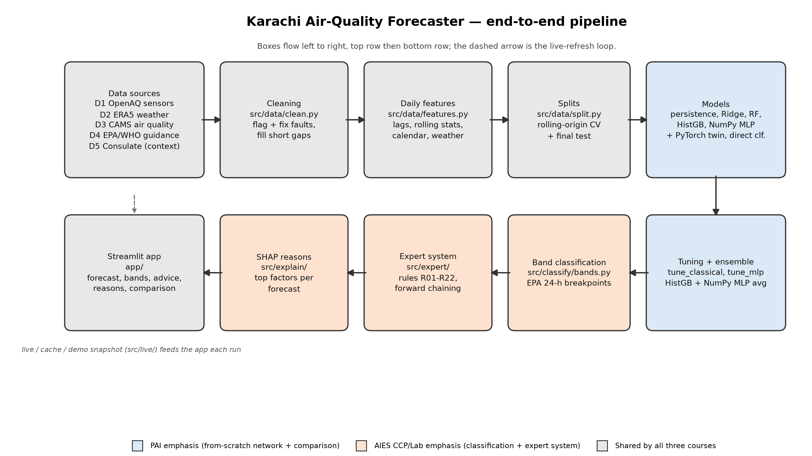

# Methodology

One-page walkthrough of the pipeline in `figures/pipeline.svg` / `pipeline.png`
(regenerate with `uv run python docs/report/figures/make_pipeline.py`). Each
stage below is one box in the diagram, left to right, top row then bottom row.

## 1. Data sources

Five sources, described fully in `PROJECT_SPEC.md` §5 and
`docs/report/knowledge_sources.md`: **D1** OpenAQ (14 Urban Unit AirGradient
PM2.5 sensors — the forecast target and its own lag features), **D2**
Open-Meteo ERA5 historical weather, **D3** Open-Meteo CAMS modelled air
quality, **D4** EPA/WHO guidance documents (the expert system's knowledge
base, not a time series), and **D5** the US Consulate reference monitor
(long-history context only — it ends before D1 starts, so it is never used
as training input).

## 2. Cleaning — `src/data/clean.py`

Aligns every source to one hourly, `Asia/Karachi` grid, flags faults
(negative values, spikes, flat-lines) and fills short gaps (≤3 h) by linear
interpolation; longer gaps stay missing and are counted. Rules and exact
table formats: `docs/design/phase2_data_contract.md` §1.

## 3. Daily features — `src/data/features.py`

Builds one row per `(sensor_id, date D)`: PM2.5 lags and rolling stats,
calendar (sine/cosine), wind as u/v components, modelled PM2.5/NO2/dust, and
a sensor one-hot. Table format: `docs/design/phase2_data_contract.md` §2.

**Leakage rule:** every `past_*`/lag/rolling feature for day D uses only
hourly rows with `time < D 00:00`. Only the `fc_*` weather/CAMS columns and
the targets may use hours inside day D itself — because the forecast is
**issued at 00:00 PKT on day D** and covers D's own 24 hours. Training and
testing use the **recorded** ERA5/CAMS values for day D as a stand-in for a
weather forecast ("**perfect prognosis**" — the model sees the actual
weather, not a forecast of it); the live pipeline (`src/live/pipeline.py`)
instead uses Open-Meteo's **forecast** for day D, since the real weather
isn't known yet at 00:00. This is a known gap between train/test skill and
live skill, noted as a limitation.

## 4. Splits — `src/data/split.py`

Time-based only, never shuffled: 8 rolling-origin cross-validation folds
(expanding training window, each fold tests the next 30 days) for model
selection, plus one final test block (2026-09-01 → 2026-11-08) scored once,
after every modelling choice is frozen. A 1-day embargo gap sits before each
test block so no lag feature can see into the test window.

## 5. Models — `src/models/`

A ladder from simple to complex, each one beating the last on the CV folds:
persistence ("forecast = the day before") → Ridge regression (the official
baseline) → Random Forest / HistGB → the NumPy MLP (hand-written forward
pass, backprop, Adam, verified by a numerical gradient check) → its PyTorch
twin (same architecture and initial weights, used for SHAP's
`DeepExplainer`) → direct band classifiers (logistic regression, Random
Forest) as the alternative route to the AIES classification task.

## 6. Tuning + ensemble — `src/evaluate/tune_classical.py`, `tune_mlp.py`

Grid/random search on the CV folds only (never the final test). The
production forecaster is an equal-weight average of the tuned HistGB
regressor and the tuned NumPy MLP (`src/models/ensemble.py`,
`src/models/final.py`) — picked over any single model on CV skill;
evidence in `docs/report/model_selection.md`.

## 7. Band classification — `src/classify/bands.py`

Applies the EPA 2024 PM2.5 breakpoints (24-h average) to the ensemble's
regression output ("regress-then-band"), compared against the direct
classifiers from stage 5. Hazardous is merged into Very Unhealthy (zero
Hazardous days in the training data).

## 8. Expert system — `src/expert/`

A small forward-chaining rule base (R01–R22, `docs/report/expert_system.md`
and `knowledge_sources.md`) turns the band, the forecast trend and a
session-only user profile (sensitive group? outdoor plans?) into advice
quoted from EPA/WHO guidance, with an explanation of which rules fired.

## 9. SHAP reasons — `src/explain/`

`TreeExplainer` on the tree model and `DeepExplainer` on the PyTorch twin
give per-forecast, plain-English reasons ("low wind speed raised the
forecast by ~8 µg/m³") and a global feature-importance summary
(`docs/report/explainability.md`).

## 10. Streamlit app — `app/`

Ties every stage together: pick a sensor, see the forecast, band, advice
and SHAP reasons, plus a model-comparison page. Falls back from a live
fetch to a cached snapshot to a stored demo day (`src/live/`) so the app
still works offline.
