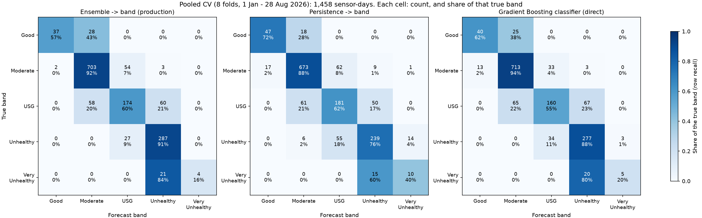
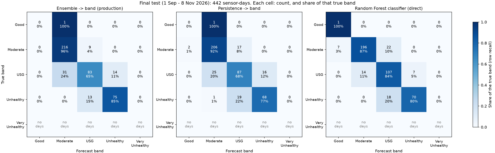

# Model selection and final test (Phase 5)

How the forecaster was chosen, and how it did on data it had never seen. The forecast is the
24-hour average PM2.5 for the day, issued at 00:00 PKT, sorted into five EPA bands (Good,
Moderate, Unhealthy for Sensitive Groups (USG), Unhealthy, Very Unhealthy; Hazardous merged into
Very Unhealthy). Numbers come from `results/tuning/` (cross-validation), `results/final_test/`
(the one-time final test) and `results/bands/` (band evidence with confidence intervals, built
from the saved predictions by `python -m src.evaluate.band_report`, no retraining).

## How the model was chosen

**Rule, in priority order:**

1. **Fewest missed Unhealthy-or-worse days** (true band Unhealthy or Very Unhealthy, forecast
   cleaner). A missed bad day costs more health-wise than a false alarm: people who should have
   stayed indoors do not.
2. Then **accuracy** (share of days in the right band).
3. Then **macro-F1** (F1 averaged over the bands, so rare bands count as much as common ones).

The regressors were first tuned, and the ensemble's members picked, on mean absolute error (MAE);
the band routes were then compared with this rule.

**Official baselines:** Ridge regression (regression, then banded) and logistic regression
(direct band classification). Persistence (the day's average = the previous day's average) is the
naive yardstick every model must beat.

## Row sets used

Every number below says which of these it uses.

- **Pooled CV:** 8 rolling-origin folds. Each fold trains on every day before a 30-day block
  (with a 1-day gap) and tests on that block; the blocks run 1 Jan – 28 Aug 2026. All 8 test
  blocks are scored together: **1,458 labelled sensor-days over 240 dates**. All settings were
  chosen on these folds.
- **Final test:** 1 Sep – 8 Nov 2026, **442 sensor-days over 69 dates**, trained on everything
  before it and scored **once**, after every choice was frozen (`src/evaluate/final_test.py`
  refuses a second run).

*Correction:* an earlier version of this page (and the Phase 4 note in `ROADMAP.md`) said the pooled
CV had 2,224 sensor-days. That was wrong. Every saved CV prediction file
(`results/baselines_cv_predictions.parquet` and `results/tuning/*_cv_predictions.parquet`) has
1,458 rows per model, and re-deriving the folds from `src/data/split.py` gives the same 1,458.
2,224 matches no row set in the project (the development period has 3,585 labelled rows;
1 Jan – 31 Aug has 1,476, and the last 3 days of August fall outside the 8th block). All CV
numbers here and in `results/baselines_summary.md` were already computed on the 1,458 rows; only
the label was wrong.

*Confidence intervals:* 95% bootstrap intervals with 2,000 resamples (seed 42). Whole **dates**
are resampled, not single rows, because the sensors on one day share the same weather and smoke
and so are not independent. Two models are compared on the same resampled dates (a *paired*
difference). If the interval of a difference contains 0, the gap is within noise.

## Tuning (pooled CV, 1,458 sensor-days, MAE in µg/m³)

| Model | Default | Tuned | Key settings |
|---|---|---|---|
| Persistence | 8.70 | — | — |
| Ridge (official baseline) | 7.68 | 7.22 | alpha 150 |
| Random Forest | 6.79 | 6.54 | 500 trees, depth 15, min leaf 5, 50% of features per split |
| Gradient Boosting | — | **6.30** | 100 rounds, 31 leaves, L2 0.1 |
| NumPy network | 11.21 | 6.63 | 32 hidden units, L2 0.1, change-from-previous-day target, no calendar features |

**Why the untuned network was so bad, and what fixed it** (`results/tuning/mlp_numpy_diagnosis.csv`):

- **Unseen seasons.** The data starts in June 2025, so the folds testing March–May had never seen
  those days of the year. The network read the unfamiliar calendar values as winter and
  over-forecast: in fold 2 its average error was +21.9 µg/m³ too high. Dropping the three
  calendar features cut that bias to −2.5.
- **Overfitting.** Training error was ~3 µg/m³ against ~15–17 on the held-out rows. A smaller
  network (32 units instead of 64+32) with a much larger weight penalty (L2 0.1) fixed most of it.
- **Predicting the change, not the level.** The network learns the difference from a simple
  "previous day → this day" line (fitted on training rows only), which is a much easier target.
- **Stable across random seeds:** MAE 6.57 / 6.63 / 6.70 for seeds 0, 1, 2.

## Ensemble (pooled CV, 1,458 sensor-days)

Averaging models helps because they make different mistakes (prediction correlation 0.97, not 1).

| Combination (equal-weight average) | MAE | Skill | Band accuracy | Band macro-F1 |
|---|---|---|---|---|
| All four (Ridge + RF + GB + network) | 6.13 | +29.5% | — | 0.642 |
| **Gradient Boosting + NumPy network** | **6.16** | **+29.2%** | **82.6%** | **0.674** |
| Gradient Boosting alone | 6.30 | +27.5% | — | 0.645 |
| NumPy network alone | 6.63 | +23.8% | 80.7% | 0.659 |

**Chosen:** Gradient Boosting + NumPy network. It is within 0.03 µg/m³ of the four-model average,
simpler, has the best band score of any combination, and keeps the from-scratch network in the
final system. Equal weights on purpose: fitting weights on the same folds would overfit them.
Against the official regression baseline, its MAE is 15% lower than tuned Ridge (6.16 vs 7.22).

## Band route: predict the number, or the band directly? (pooled CV, 1,458 sensor-days, 240 dates)

| Route | Accuracy | Macro-F1 | Unhealthy-or-worse missed | False alarms |
|---|---|---|---|---|
| Persistence → band | 78.9% | **0.678** | 18.0% | 5.4% |
| Logistic regression (direct, official baseline) | 73.1% | 0.589 | 23.9% | 4.0% |
| Random Forest classifier (direct) | 78.3% | 0.651 | 15.0% | 3.6% |
| Gradient Boosting classifier (direct, best direct by the rule) | 82.0% | 0.664 | 10.0% | 6.3% |
| Ridge → band (official regression baseline, tuned) | 79.6% | 0.582 | 5.6% | 8.7% |
| **Ensemble → band** | **82.6%** | 0.674 | 8.0% | 5.6% |

With 95% intervals (`results/bands/bootstrap_ci.csv`):

| Measure | Ensemble | Persistence | Ensemble − persistence |
|---|---|---|---|
| Accuracy | 0.826 [0.798, 0.855] | 0.789 [0.757, 0.820] | **+0.038 [+0.008, +0.069]** |
| Macro-F1 (all 5 bands; all occur in CV) | 0.674 [0.613, 0.747] | 0.678 [0.613, 0.721] | −0.004 [−0.064, +0.083] |
| Unhealthy-or-worse missed | 0.080 [0.043, 0.127] | 0.180 [0.099, 0.276] | **−0.100 [−0.174, −0.035]** |
| False alarms | 0.056 [0.032, 0.084] | 0.054 [0.032, 0.078] | +0.003 [−0.016, +0.022] |

**What this shows, honestly:**

- **Macro-F1 does not separate the ensemble from persistence.** Persistence is 0.678 and the
  ensemble 0.674; the difference is −0.004 with an interval from −0.064 to +0.083. That is noise.
  Persistence scores well on macro-F1 because it copies the previous day, so it reaches the rare
  extreme bands as often as they happen (Very Unhealthy recall 40% vs the ensemble's 16%).
- **The ensemble's real gains are safety and accuracy, and both are outside the noise:** it misses
  10 percentage points fewer Unhealthy-or-worse days (8.0% vs 18.0%) and is 3.8 points more
  accurate, at no measurable cost in false alarms.
- **Against the best direct classifier** (Gradient Boosting), the ensemble is slightly ahead on
  every measure but all the gaps are within noise (accuracy +0.7 points [−1.2, +2.6]; missed
  bad days −2.1 points [−5.4, +0.8]).
- **Against logistic regression** (official classification baseline), the ensemble is clearly
  better: accuracy +9.5 points [+6.5, +12.7], macro-F1 +0.085 [+0.017, +0.183], missed bad days
  −15.9 points [−25.3, −7.6].
- **Against Ridge → band** (official regression baseline), the ensemble is more accurate
  (+3.1 points [+1.4, +4.9]), has a much higher macro-F1 (+0.091 [+0.034, +0.161]) and fewer
  false alarms (−3.0 points [−5.2, −1.3]). **But Ridge misses fewer bad days** (5.6% vs 8.0%,
  difference +2.4 points [+0.3, +5.0]), so applied strictly, rule 1 would pick Ridge here. Ridge
  gets that by forecasting "Unhealthy" too often: it never forecasts Very Unhealthy, flags 8.7% of
  cleaner days, and its MAE is 15% worse. That is the same trade as adding a safety margin (below),
  which we rejected for the band shown. Ridge was not one of the band routes compared when the
  choice was made; this table adds it so the trade is visible. On the final test the two miss the
  same share of bad days (14.8% each).

**Chosen:** predict PM2.5 with the ensemble, then look up its band. Among the routes compared at
the time (persistence, the direct classifiers, the ensemble) it misses the fewest Unhealthy-or-worse
days and is the most accurate. Its weak spot is the rare extremes: it recognises only 57% of Good
days and 16% of the 25 Very Unhealthy days, because averaging models pulls extreme forecasts
toward the middle.

*Pooled CV confusion matrices (1,458 sensor-days). Rows are the true band, columns the forecast
band; each cell shows the count and the share of that true band. Almost every ensemble miss of an
Unhealthy day lands one band lower (USG), and Very Unhealthy days are mostly called Unhealthy.*

**Safety margin.** Adding +5 µg/m³ before banding cuts missed Unhealthy days to 4.1% but raises
false alarms to 9.1% and means "Good" is never forecast. So the margin is **not** applied to the
band shown; it belongs in the advice layer (Phase 6): when a forecast is near a boundary, the
advice follows the worse band and says so.

## Final test (1 Sep – 8 Nov 2026, 442 sensor-days, scored once)

| Model | MAE | RMSE | R² | Skill |
|---|---|---|---|---|
| Persistence | 5.82 | 8.64 | 0.762 | — |
| Ridge (official baseline) | 5.60 | 7.72 | 0.810 | +3.8% |
| Random Forest | 5.37 | 7.80 | 0.806 | +7.8% |
| Gradient Boosting | 4.73 | 6.85 | 0.851 | +18.7% |
| NumPy network | 4.98 | 6.97 | 0.846 | +14.5% |
| **Ensemble (GB + network)** | **4.63** | **6.61** | **0.861** | **+20.5%** |

The ensemble's MAE is 17% lower than the Ridge baseline's (4.63 vs 5.60).

This period has 1 Good day, 225 Moderate, 128 USG, 88 Unhealthy and **no** Very Unhealthy days.
So macro-F1 over all five bands is dragged down for every model by a band that never occurs; the
fairer number is **macro-F1 over the 4 bands that occur** ("present").

| Bands | Accuracy | Macro-F1 (5 bands) | Macro-F1 (4 present) | Unhealthy-or-worse missed | False alarms |
|---|---|---|---|---|---|
| Persistence → band | 81.7% | 0.477 | 0.596 | 22.7% | 4.5% |
| Ridge → band (official baseline) | 81.9% | 0.473 | 0.591 | 14.8% | 5.6% |
| Random Forest classifier (direct)* | 84.6% | **0.550** | **0.688** | 20.5% | **2.0%** |
| **Ensemble → band** | **84.6%** | 0.495 | 0.618 | **14.8%** | 4.0% |

\*The only direct classifier run on the final test (it was the planned comparison when the test
was frozen). Logistic regression and the Gradient Boosting classifier were not run on it, and
re-running the final test to add them would break the "scored once" rule.

With 95% intervals (69 dates resampled):

| Measure | Ensemble | Ensemble − persistence | Ensemble − RF classifier |
|---|---|---|---|
| Accuracy | 0.846 [0.786, 0.898] | +0.029 [−0.005, +0.065] | 0.000 [−0.047, +0.039] |
| Macro-F1 (4 present) | 0.618 [0.565, 0.661] | +0.022 [−0.007, +0.053] | −0.069 [−0.176, +0.013] |
| Unhealthy-or-worse missed | 0.148 [0.058, 0.263] | −0.080 [−0.182, +0.014] | −0.057 [−0.130, +0.012] |
| False alarms | 0.040 [0.011, 0.078] | −0.006 [−0.023, +0.011] | +0.020 [0.000, +0.050] |

The ensemble again misses the fewest bad days (13 of 88; persistence misses 20) and ties for the
best accuracy, so the CV ranking holds in direction. But the final test is short (69 days), and
none of these gaps is outside the noise on its own. The Random Forest classifier has the best
macro-F1 and the fewest false alarms; its higher macro-F1 comes from the USG band and from
catching the single Good day. Errors are smaller than in CV because Sep–Nov is cleaner than Jan–Aug.

*Final-test confusion matrices (442 sensor-days). The Very Unhealthy row is empty: no such day occurred.*

**Limits of the final test.** It contains 1 Good day and no Very Unhealthy days, so per-band
results for Good and Very Unhealthy come from CV instead. Weather for the forecast day uses
recorded values as a stand-in for weather forecasts (*perfect-prognosis*), so live accuracy will
be somewhat lower.

## Fairness across sites (ensemble, pooled CV, 1,458 sensor-days)

Per-site results are in `results/fairness/ensemble/` (`python -m src.evaluate.fairness --model
ensemble --features data/processed/features.parquet`). Sensor S14 has no rows in the CV blocks,
so 13 sites are scored.

- **Forecast error is uneven.** MAE ranges from 4.6 µg/m³ (Climate Action Center, S1) to 15.6
  (DG House DHA Phase 5, S10), against 6.2 overall; 6 sites are more than 25% above it. Error
  follows each site's pollution level (rank correlation with mean PM2.5 0.77) more than its data
  gaps (−0.39), and the worst sites are also the ones with the fewest CV rows (14–66).
- **Missed bad days are spread more evenly.** The miss rate is highest at Aga Khan University
  (S4): 5 of its 25 Unhealthy-or-worse days (20%). It is 0–15% everywhere else.
- **False alarms are concentrated at the sparse, dirty sites:** DG House (S10) 5 of 14 cleaner
  days (36%), NED University (S7) 23%, Aman Khan Kaka Khail (S9) 17%, against 2–7% at the
  well-covered sites. Orangi (S11, 1 of 1) and Karachi Zoo (S12, 4 of 8) look worse still, but
  rest on very few cleaner days.
- **Practical meaning:** at the sparse, high-pollution sites the forecast leans toward calling a
  day bad, which is the safer direction. Their forecasts deserve wider uncertainty, which the app
  already notes for sites with missing readings.

## Production model

`uv run python -m src.evaluate.final_test --save-production` refits the preprocessor and the
ensemble on **all** labelled rows (Jun 2025 – Nov 2026) and saves `models/final_ensemble.pkl`
for the app. Settings live in `src/models/final.py`.
