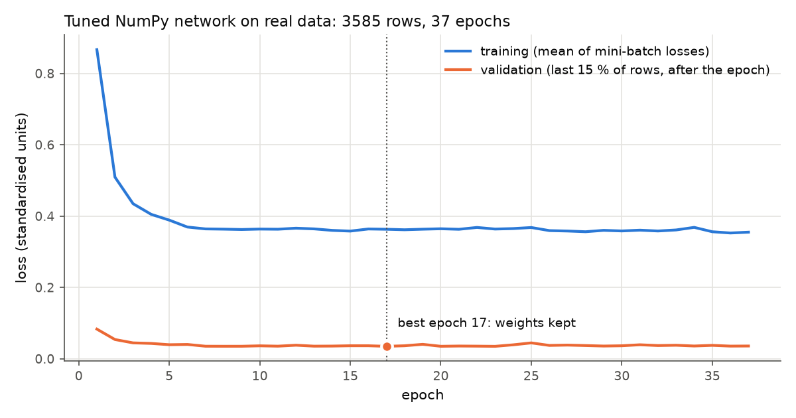

# How the network learns (the from-scratch NumPy network)

The proposal promised "a neural network built from scratch in NumPy, applying linear algebra and
calculus to show how the model learns, validated against PyTorch". This chapter is that
derivation. Every equation below is the one the code runs: signs, means versus sums, the Huber
$\delta$ and where Adam's $\epsilon$ goes were checked against `src/models/numpy_nn/`, and a
one-step hand calculation from these equations matched the code exactly (difference 0.0).

Numbers come from two commands, both re-runnable:

```
uv run python -m src.models.numpy_nn.gradcheck   # -> results/numpy_vs_torch/gradcheck.csv
uv run python -m src.models.torch_nn             # -> results/numpy_vs_torch/summary.{json,md}, *.png
```

## 1. Notation and shapes

A mini-batch is a matrix with **one row per example** (one sensor-day).

| Symbol | Shape | Meaning |
|---|---|---|
| $n$ | — | rows in the mini-batch (32, except a smaller last batch per epoch) |
| $L$ | — | number of dense layers ($L-1$ hidden layers + 1 output layer) |
| $d_l$ | — | width of layer $l$; $d_0$ = number of input features, $d_L = 1$ |
| $X = A^{(0)}$ | $n \times d_0$ | input batch (already imputed and standard-scaled) |
| $W^{(l)}$ | $d_{l-1} \times d_l$ | weights of layer $l$ ("inputs × outputs") |
| $b^{(l)}$ | $d_l$ | bias of layer $l$ |
| $Z^{(l)}$ | $n \times d_l$ | pre-activation of layer $l$ |
| $A^{(l)}$ | $n \times d_l$ | activation (output) of layer $l$ |
| $P = Z^{(L)}$ | $n \times 1$ | prediction |
| $y$ | $n \times 1$ | target (standardised, see §6) |
| $\mathbf{1}$ | $n \times 1$ | column of ones |
| $\odot$ | — | element-wise product |

The tuned network (`src/models/final.py`, `MLP_PARAMS`) has $L = 2$: $d_0 = 55$ inputs, one
hidden layer of $d_1 = 32$ ReLU units, and $d_2 = 1$ output.

## 2. Forward pass

For $l = 1, \dots, L$:

$$Z^{(l)} = A^{(l-1)} W^{(l)} + \mathbf{1}\, b^{(l)\top}$$

$(n \times d_{l-1})(d_{l-1} \times d_l) = n \times d_l$; the term $\mathbf{1} b^{\top}$ just adds
the same bias row to every example (NumPy broadcasting). Hidden layers then apply a non-linearity
$\varphi$ element-wise, the output layer does not:

$$A^{(l)} = \varphi\!\left(Z^{(l)}\right) \quad (l < L), \qquad P = Z^{(L)}.$$

Without $\varphi$ the whole network would collapse into one matrix product, i.e. a linear model.

**Activations** and the derivatives backpropagation needs:

| Name | $\varphi(z)$ | $\varphi'(z)$ | Note |
|---|---|---|---|
| ReLU | $\max(0, z)$ | $1$ if $z > 0$, else $0$ | derivative at exactly 0 taken as 0, like PyTorch |
| LeakyReLU | $z$ if $z > 0$, else $\alpha z$ | $1$ if $z > 0$, else $\alpha$ | $\alpha = 0.01$ (PyTorch default); a unit never goes fully "dead" |
| Tanh | $\tanh z$ | $1 - \tanh^2 z$ | backward reuses the cached output $A$ |

**Dropout (inverted)**, optional after each hidden activation. In training, each unit is kept
with probability $1 - p$:

$$\tilde A = A \odot \frac{M}{1-p}, \qquad M_{ij} \sim \text{Bernoulli}(1-p).$$

Dividing by $1-p$ keeps the expected value unchanged ($\mathbb{E}[\tilde A] = A$), so at
prediction time dropout is simply switched off with no rescaling. Its backward pass multiplies by
the same $M/(1-p)$. The tuned network uses $p = 0$.

## 3. Losses

Let the residual be $r = P - y$ ($n \times 1$). Both losses **average** over the batch, exactly
like PyTorch's `reduction="mean"`.

**Mean squared error**

$$\mathcal{L}_{\text{MSE}} = \frac{1}{n} \sum_{i=1}^{n} r_i^2, \qquad
\frac{\partial \mathcal{L}_{\text{MSE}}}{\partial P} = \frac{2}{n}\, r.$$

**Huber loss** with threshold $\delta > 0$:

$$\ell_\delta(r) = \begin{cases} \tfrac12 r^2 & |r| \le \delta \\ \delta\left(|r| - \tfrac12\delta\right) & |r| > \delta \end{cases}
\qquad
\mathcal{L}_{\text{Huber}} = \frac{1}{n}\sum_{i=1}^{n} \ell_\delta(r_i), \qquad
\frac{\partial \mathcal{L}_{\text{Huber}}}{\partial P} = \frac{1}{n}\,\operatorname{clip}(r, -\delta, \delta).$$

The two pieces meet with equal value and slope at $|r| = \delta$. Small errors are treated like
MSE, but a huge error (a smoke-event day) pulls on the weights with a force capped at $\delta/n$
instead of one that keeps growing. Because targets are standardised (§6), $\delta$ is in
standard deviations, not µg/m³ (default $\delta = 1$).

Two conventions to note, both matching PyTorch (`nn.MSELoss`, `nn.HuberLoss`):

- MSE has **no** $\tfrac12$ in front, so its gradient has the factor 2. Huber's quadratic branch
  **does** have the $\tfrac12$, so for small residuals Huber's gradient is half of MSE's.
- $n$ is the number of rows in *this* batch, so a smaller last batch is still averaged correctly.

## 4. Backpropagation

Write $\Delta^{(l)} = \partial \mathcal{L} / \partial Z^{(l)}$ ($n \times d_l$): how much the loss
changes if each pre-activation moves. Start at the output and walk backwards (the chain rule, one
layer at a time):

$$\Delta^{(L)} = \frac{\partial \mathcal{L}}{\partial P} \quad \text{(from §3)}$$

For each layer $l = L, L-1, \dots, 1$:

$$\frac{\partial \mathcal{L}}{\partial W^{(l)}} = A^{(l-1)\top}\, \Delta^{(l)} \quad (d_{l-1} \times d_l), \qquad
\frac{\partial \mathcal{L}}{\partial b^{(l)}} = \Delta^{(l)\top} \mathbf{1} \quad (d_l), \qquad
\frac{\partial \mathcal{L}}{\partial A^{(l-1)}} = \Delta^{(l)}\, W^{(l)\top} \quad (n \times d_{l-1})$$

and, through the activation of the layer below,

$$\Delta^{(l-1)} = \frac{\partial \mathcal{L}}{\partial A^{(l-1)}} \odot \varphi'\!\left(Z^{(l-1)}\right)
\quad \left(\text{times } \tfrac{M}{1-p} \text{ as well if that layer has dropout}\right).$$

Every gradient has the same shape as the thing it belongs to — a quick check that the matrix
products are the right way round. The bias gradient is the column sum of $\Delta^{(l)}$ because
the bias is added to every row.

**Why the batch mean appears — and where.** Many textbooks write
$\partial\mathcal{L}/\partial W = \frac{1}{n} A^\top \Delta$ with a per-example $\Delta$. The code
does the same arithmetic in a different place: the $\frac1n$ is already inside
$\Delta^{(L)} = \partial\mathcal{L}/\partial P$ (§3), and every later step is linear in $\Delta$,
so it carries through. The dense layer therefore **sums** over rows ($A^\top\Delta$ and the column
sum for $b$) and the result is still the *average* per-example gradient. Averaging rather than
summing keeps the step size independent of the batch size.

**Worked shapes for the tuned network** ($n = 32$, $d_0 = 55$, $d_1 = 32$):
$\Delta^{(2)}$ is $32 \times 1$ → $\partial\mathcal{L}/\partial W^{(2)} = A^{(1)\top}\Delta^{(2)}$ is
$32 \times 1$ → $\partial\mathcal{L}/\partial A^{(1)} = \Delta^{(2)} W^{(2)\top}$ is $32 \times 32$ →
ReLU mask → $\Delta^{(1)}$ is $32 \times 32$ → $\partial\mathcal{L}/\partial W^{(1)} = X^\top \Delta^{(1)}$
is $55 \times 32$.

**L2 regularisation (weight decay).** The objective actually minimised adds a penalty on the
weight matrices (not the biases — shifting a bias does not make the function more wiggly):

$$J = \mathcal{L} + \frac{\lambda}{2} \sum_{l=1}^{L} \big\| W^{(l)} \big\|_F^2, \qquad
g_W = \frac{\partial J}{\partial W^{(l)}} = \frac{\partial \mathcal{L}}{\partial W^{(l)}} + \lambda W^{(l)}, \qquad
g_b = \frac{\partial \mathcal{L}}{\partial b^{(l)}}.$$

With plain SGD this is literally "decay": $W \leftarrow (1 - \eta\lambda) W - \eta\,\partial\mathcal{L}/\partial W$
shrinks every weight a little each step. Code details: the penalty is not divided by $n$ and is
added once per mini-batch step; the losses recorded in `history_` are the data loss
$\mathcal{L}$ only. The tuned network uses $\lambda = 0.1$.

## 5. Optimisers

Let $\theta$ be any parameter array, $g_t$ its gradient at step $t$ (including $\lambda\theta$ for
weights), and $\eta$ the learning rate.

**Mini-batch SGD:** $\theta \leftarrow \theta - \eta\, g_t$.

**Adam** (Kingma & Ba, 2015; tuned network: $\eta = 10^{-3}$), all operations element-wise,
$m_0 = v_0 = 0$:

$$m_t = \beta_1 m_{t-1} + (1-\beta_1)\, g_t, \qquad v_t = \beta_2 v_{t-1} + (1-\beta_2)\, g_t^2$$

$$\hat m_t = \frac{m_t}{1-\beta_1^t}, \qquad \hat v_t = \frac{v_t}{1-\beta_2^t}, \qquad
\theta \leftarrow \theta - \eta\, \frac{\hat m_t}{\sqrt{\hat v_t} + \epsilon}$$

with $\beta_1 = 0.9$, $\beta_2 = 0.999$, $\epsilon = 10^{-8}$ (PyTorch's defaults). $m$ is a
running average of the direction, $v$ of the squared size. **Bias correction:** because $m$ and
$v$ start at 0 they are too small early on; dividing by $1-\beta^t$ fixes that. Example: at
$t = 1$, $\hat m_1 = g_1$ and $\hat v_1 = g_1^2$, so the first step is
$\eta\, g_1/(|g_1| + \epsilon) \approx \eta\,\operatorname{sign}(g_1)$ — every weight moves by
about $\eta$, whatever the scale of its gradient. Note $\epsilon$ is added **after** the square
root, as in PyTorch.

The L2 term is put into $g_t$ *before* the moments (classic L2, PyTorch's
`torch.optim.Adam(weight_decay=λ)`), not applied separately afterwards as in AdamW.

## 6. Initialisation, target scaling and early stopping

**Initial weights** (`init.py`), biases start at 0, $\text{fan}_{\text{in}} = d_{l-1}$,
$\text{fan}_{\text{out}} = d_l$:

- **He** for ReLU / LeakyReLU hidden layers: $W_{ij} \sim \mathcal{N}\!\left(0,\; \tfrac{2}{\text{fan}_{\text{in}}}\right)$.
- **Xavier/Glorot** for tanh hidden layers and the (linear) output layer:
  $W_{ij} \sim \mathcal{U}(-a, a)$, $a = \sqrt{6/(\text{fan}_{\text{in}} + \text{fan}_{\text{out}})}$,
  i.e. variance $a^2/3 = 2/(\text{fan}_{\text{in}} + \text{fan}_{\text{out}})$.

Why: one pre-activation is a sum of $\text{fan}_{\text{in}}$ terms, so
$\operatorname{Var}(z) \approx \text{fan}_{\text{in}} \operatorname{Var}(w)\, \mathbb{E}[a^2]$. To keep
the signal the same size from layer to layer we need $\text{fan}_{\text{in}}\operatorname{Var}(w)\,\mathbb{E}[a^2] \approx \operatorname{Var}(a_{\text{prev}})$.
ReLU zeroes about half its inputs ($\mathbb{E}[a^2] = \tfrac12\operatorname{Var}(z)$), hence the 2 in
He. Xavier balances the forward pass ($\text{fan}_{\text{in}}$) and the backward pass
($\text{fan}_{\text{out}}$). Too large and activations and gradients explode; too small and they
vanish. All randomness comes from one seed (42), split into separate streams for
initialisation, batch shuffling and dropout.

**Target scaling.** PM2.5 runs from about 5 to 250 µg/m³. The network learns
$\tilde y = (y - \mu)/\sigma$, with $\mu, \sigma$ from the training rows, and `predict` maps back.
The tuned network also learns a **residual** (`variant.py`): the target is
$y - (a + b \cdot \text{yesterday's PM2.5})$, with $(a, b)$ fitted by least squares on the
training rows, and the anchor is added back at prediction time. So in the real run below the
loss is the MSE of a standardised residual ($\sigma = 16.8$ µg/m³).

**Early stopping.** The *last* 15 % of the training rows — rows sorted by date, then sensor — are
held out. After every epoch the validation loss is computed (no dropout); if it has not improved
for 20 epochs (`patience`) training stops and the weights from the best epoch are restored.

Why the *last* rows and not a random 15 %: the job is forecasting, i.e. predicting days the model
has not seen yet from earlier days. Neighbouring days are strongly correlated (smog spells last
days, and the lag/rolling features overlap), so a random hold-out would put near-copies of
training days into validation. The validation loss would look too good and training would
stop too late. Holding out the most recent block copies the real situation: learn from the past,
judge on the future.

## 7. Verification

### 7.1 Gradient check (is backward the true derivative of forward?)

A derivative is a slope, so it can be measured with the forward pass alone. Nudge one number
$w$ by $\varepsilon = 10^{-6}$ each way (a **central difference**):

$$\frac{\partial J}{\partial w} \approx \frac{J(w + \varepsilon) - J(w - \varepsilon)}{2\varepsilon}$$

(error of order $\varepsilon^2$), do this for every entry, and compare with the backward pass using
the **relative error**

$$\text{rel}(a, \hat a) = \frac{\lVert a - \hat a \rVert_2}{\lVert a \rVert_2 + \lVert \hat a \rVert_2}.$$

In float64, a correct gradient gives about $10^{-8}$ or less; a wrong one gives something near 1.
The checked objective is the full $J$ including the L2 term, so the optimiser's actual gradient
$g$ is what is tested.

**Measured** (`results/numpy_vs_torch/gradcheck.csv`): a $4 \to 6 \to 5 \to 1$ network on 12 random
rows, $\lambda = 0.01$, every activation × {MSE, Huber with $\delta = 0.5$}, every parameter. With
$\delta = 0.5$, 8 of the 12 residuals are in Huber's linear branch and 4 in the quadratic one, so
both branches are tested.

| | Relative error |
|---|---|
| Parameters checked | 36 arrays (3 activations × 2 losses × 6 arrays), 71 numbers per network |
| Worst | $7.8 \times 10^{-10}$ (LeakyReLU, Huber, `dense2.W`) |
| Best | $9.0 \times 10^{-12}$ (ReLU, Huber, `dense3.b`) |
| Test threshold | $10^{-6}$ |

The unit tests also check each layer and loss on its own, and that a deliberately wrong gradient
(Huber without the clip) is caught.

### 7.2 PyTorch equivalence on the real data

The gradient check proves the derivatives. To prove the whole training procedure — losses,
optimiser, L2, batching — the same network is rebuilt in PyTorch
(`src/models/torch_nn/model.py`): `nn.Linear`, PyTorch's activations and losses, **autograd**
for the gradients and `torch.optim.Adam` for the updates. Nothing of the NumPy maths is reused.

What is identical: the training loop (`estimator_base.py`), the seed, therefore the initial
weights (checked: difference exactly 0) and the order of the 3,552 mini-batches; float64 on the
CPU; the tuned settings from `final.py`. The two extras of the tuned model (drop the three
calendar columns; learn the residual from persistence) live in the `MLPVariant` wrapper, so both
networks run inside that same wrapper and get exactly the same inputs and targets.

Data: all 3,585 labelled rows before 1 Sep 2026, preprocessor fitted on them. Predictions are
compared on the 442 final-test rows (1 Sep – 8 Nov 2026). Only the two models' outputs are
compared with each other; the true values are not read, so this is **not** a score on the final
test.

| Quantity | NumPy vs PyTorch |
|---|---|
| Prediction difference, max / mean | $1.4 \times 10^{-14}$ / $8.4 \times 10^{-16}$ µg/m³ |
| Final weight difference, max per layer (`W1`, `b1`, `W2`, `b2`) | $6.9 \times 10^{-17}$, $8.3 \times 10^{-17}$, $1.1 \times 10^{-16}$, $2.8 \times 10^{-17}$ |
| Per-epoch loss difference, max (train / validation) | $1.1 \times 10^{-16}$ / $1.4 \times 10^{-17}$ |
| Per-step loss difference, max over 3,552 steps | $8.9 \times 10^{-16}$ |
| Epochs run / best epoch | 37 / 17 for both |
| Training time (saved run) | NumPy 2.7 s, PyTorch 14.1 s (other runs: 0.9 s vs 31 s — varies with machine load) |

Float64 has about 16 significant digits, so differences of $10^{-16}$ in quantities of size 1 are
rounding noise: the two implementations compute the same numbers in a slightly different order.
`results/numpy_vs_torch/loss_curves.png` shows the two loss curves lying on top of each other, with
the difference on a log scale. PyTorch is slower here only because each of the 3,552 tiny steps
(a $32 \times 55$ batch) pays its fixed per-call overhead (autograd graph, optimiser bookkeeping);
for networks this small NumPy's few matrix products are cheaper. The Phase 4 note in
`ROADMAP.md` (≈ 1e-13 µg/m³, 4 s vs 38 s) was for the earlier untuned 64-32 network; this run
reproduces the same conclusion for the tuned model and saves it.

## 8. The learning curve of the tuned network



Training loss (blue) drops from 0.87 to about 0.37 within six epochs and then barely moves:
with one hidden layer of 32 units and strong L2 ($\lambda = 0.1$) the network reaches its capacity
quickly. Validation loss (orange) bottoms out at epoch 17 (0.035) and shows no improvement for the
next 20 epochs, so training stops at epoch 37 and the epoch-17 weights are kept. The validation
loss is far *below* the training loss not because the model does better on new data in general,
but because the validation block is the most recent 15 % — 3 June to 31 August 2026, the clean
monsoon season (PM2.5 standard deviation 8.7 µg/m³ against 33.4 in the training part, which
includes the winter smog). This is exactly why the model was then chosen on eight rolling folds
spread over the year (`docs/report/model_selection.md`), not on one validation block.

(The training curve is the average of the mini-batch losses during the epoch, measured before
each update; the validation curve is measured once after the epoch.)

## 9. Where this is in the code

| Equation / idea | File : function |
|---|---|
| Forward $Z = AW + b$; $\partial/\partial W$, $\partial/\partial b$, $\partial/\partial A$ | `src/models/numpy_nn/layers.py` : `Dense.forward`, `Dense.backward` |
| ReLU, LeakyReLU, Tanh and $\varphi'$ | `layers.py` : `ReLU`, `LeakyReLU`, `Tanh` (`forward` / `backward`) |
| Inverted dropout | `layers.py` : `Dropout` |
| MSE and its gradient $2r/n$ | `losses.py` : `MSELoss.forward`, `MSELoss.backward` |
| Huber and its gradient $\operatorname{clip}(r,-\delta,\delta)/n$ | `losses.py` : `HuberLoss.forward`, `HuberLoss.backward` |
| Backprop recursion (layers in reverse) | `network.py` : `Sequential.backward` |
| One training step: forward → loss → backward → update | `network.py` : `MLPRegressorNP._train_step` |
| L2: $g = \partial\mathcal{L}/\partial W + \lambda W$; penalty $\tfrac\lambda2\sum\lVert W\rVert^2$ | `optimizers.py` : `regularised_grad`, `l2_penalty` |
| SGD, Adam with bias correction | `optimizers.py` : `SGD.step`, `Adam.step` |
| He / Xavier initialisation | `init.py` : `he_normal`, `xavier_uniform`, `init_mlp_weights` |
| Target scaling, last-15 % validation, early stopping, mini-batches | `estimator_base.py` : `BaseMLPRegressor.fit`, `_split`, `epoch_batches` |
| Residual target and dropped calendar columns | `variant.py` : `MLPVariant.fit`, `MLPVariant.predict` |
| Central differences, relative error | `gradcheck.py` : `numerical_gradient`, `relative_error`, `check_network`, `run_gradcheck` |
| PyTorch twin | `src/models/torch_nn/model.py` : `MLPRegressorTorch` |
| Real-data comparison and figures | `src/models/torch_nn/report.py` : `run`; `compare.py` : `equivalence`; `plots.py` |
