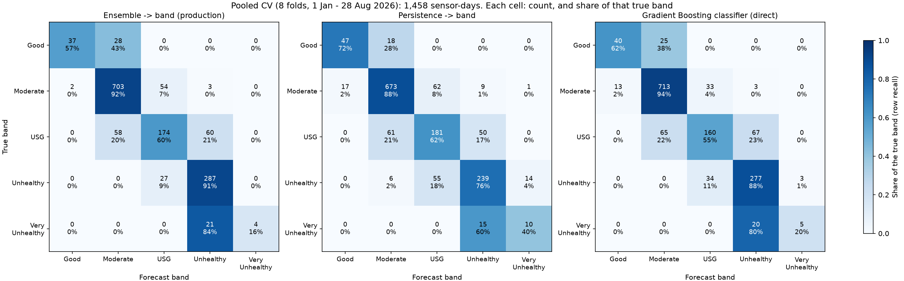
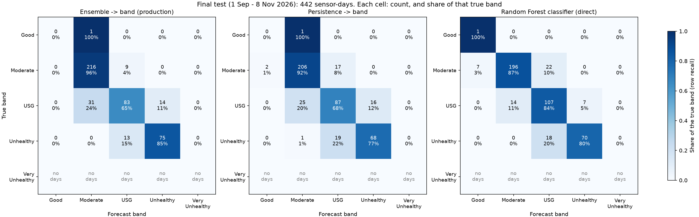

# Band classification evidence

Built by `python -m src.evaluate.band_report` from saved predictions only (no retraining;
the final test was not re-run). The forecast is the 24-hour average PM2.5 for the day,
issued at 00:00 PKT, sorted into 5 bands (Hazardous merged into Very Unhealthy).

Row sets:

- **Pooled CV (8 folds, 1 Jan - 28 Aug 2026)**: 1,458 sensor-days over 240 dates.
- **Final test (1 Sep - 8 Nov 2026)**: 442 sensor-days over 69 dates.

Selection rule (best first): fewest missed Unhealthy-or-worse days, then accuracy, then macro-F1.
Chosen by the rule in code (`selection.json`): `ensemble` (decided by rule2_accuracy).
Best direct classifier: CV = `hist_gb_clf`; final test = `random_forest_clf`
(the only direct classifier scored on the final test).

`macro_f1_all` averages F1 over all 5 bands; `macro_f1_present` only over bands that occur in that
row set's true labels. `miss_rate` = share of truly Unhealthy-or-worse days forecast as a cleaner band;
`false_alarm_rate` = share of cleaner days forecast as Unhealthy-or-worse.

## Pooled CV (8 folds, 1 Jan - 28 Aug 2026)

### Headline metrics

| model | n | n_dates | accuracy | macro_f1_all | macro_f1_present | n_present_classes | miss_rate | false_alarm_rate |
|---|---|---|---|---|---|---|---|---|
| ensemble | 1458 | 240 | 0.826 | 0.674 | 0.674 | 5 | 0.080 | 0.056 |
| persistence | 1458 | 240 | 0.789 | 0.678 | 0.678 | 5 | 0.180 | 0.054 |
| ridge | 1458 | 240 | 0.796 | 0.582 | 0.582 | 5 | 0.056 | 0.087 |
| hist_gb | 1458 | 240 | 0.807 | 0.645 | 0.645 | 5 | 0.071 | 0.066 |
| random_forest | 1458 | 240 | 0.796 | 0.609 | 0.609 | 5 | 0.062 | 0.074 |
| mlp_numpy | 1458 | 240 | 0.807 | 0.659 | 0.659 | 5 | 0.130 | 0.047 |
| hist_gb_clf | 1458 | 240 | 0.820 | 0.664 | 0.664 | 5 | 0.100 | 0.063 |
| random_forest_clf | 1458 | 240 | 0.783 | 0.651 | 0.651 | 5 | 0.150 | 0.036 |
| logistic_regression | 1458 | 240 | 0.731 | 0.589 | 0.589 | 5 | 0.239 | 0.040 |

### Bootstrap 95% CIs (2000 date-block resamples, seed 42)

Point estimate [2.5%, 97.5%]. A difference whose interval contains 0 is within noise.

| model | accuracy | macro_f1_all | macro_f1_present | miss_rate | false_alarm_rate |
|---|---|---|---|---|---|
| ensemble | 0.826 [0.798, 0.855] | 0.674 [0.613, 0.747] | 0.674 [0.613, 0.747] | 0.080 [0.043, 0.127] | 0.056 [0.032, 0.084] |
| persistence | 0.789 [0.757, 0.820] | 0.678 [0.613, 0.721] | 0.678 [0.613, 0.721] | 0.180 [0.099, 0.276] | 0.054 [0.032, 0.078] |
| hist_gb_clf | 0.820 [0.788, 0.848] | 0.664 [0.605, 0.730] | 0.664 [0.605, 0.730] | 0.100 [0.058, 0.156] | 0.063 [0.034, 0.094] |
| ridge | 0.796 [0.762, 0.827] | 0.582 [0.553, 0.612] | 0.582 [0.553, 0.612] | 0.056 [0.027, 0.094] | 0.087 [0.056, 0.123] |
| logistic_regression | 0.731 [0.698, 0.763] | 0.589 [0.538, 0.629] | 0.589 [0.538, 0.629] | 0.239 [0.142, 0.352] | 0.040 [0.017, 0.067] |
| hist_gb | 0.807 [0.778, 0.837] | 0.645 [0.582, 0.724] | 0.645 [0.582, 0.724] | 0.071 [0.035, 0.117] | 0.066 [0.040, 0.096] |
| random_forest | 0.796 [0.763, 0.827] | 0.609 [0.553, 0.668] | 0.609 [0.553, 0.668] | 0.062 [0.026, 0.114] | 0.074 [0.042, 0.111] |
| mlp_numpy | 0.807 [0.779, 0.835] | 0.659 [0.581, 0.717] | 0.659 [0.581, 0.717] | 0.130 [0.069, 0.213] | 0.047 [0.025, 0.072] |
| ensemble - persistence | 0.038 [0.008, 0.069] | -0.004 [-0.064, 0.083] | -0.004 [-0.064, 0.083] | -0.100 [-0.174, -0.035] | 0.003 [-0.016, 0.022] |
| ensemble - hist_gb_clf | 0.007 [-0.012, 0.026] | 0.009 [-0.059, 0.056] | 0.009 [-0.059, 0.056] | -0.021 [-0.054, 0.008] | -0.006 [-0.027, 0.010] |
| ensemble - ridge | 0.031 [0.014, 0.049] | 0.091 [0.034, 0.161] | 0.091 [0.034, 0.161] | 0.024 [0.003, 0.050] | -0.030 [-0.052, -0.013] |
| ensemble - logistic_regression | 0.095 [0.065, 0.127] | 0.085 [0.017, 0.183] | 0.085 [0.017, 0.183] | -0.159 [-0.253, -0.076] | 0.016 [-0.004, 0.038] |
| ensemble - hist_gb | 0.019 [0.006, 0.034] | 0.029 [-0.022, 0.061] | 0.029 [-0.022, 0.061] | 0.009 [-0.013, 0.030] | -0.010 [-0.026, 0.009] |
| ensemble - random_forest | 0.031 [0.012, 0.050] | 0.065 [0.031, 0.102] | 0.065 [0.031, 0.102] | 0.018 [-0.013, 0.050] | -0.018 [-0.043, 0.005] |
| ensemble - mlp_numpy | 0.019 [0.002, 0.038] | 0.015 [-0.030, 0.074] | 0.015 [-0.030, 0.074] | -0.050 [-0.094, -0.017] | 0.009 [0.000, 0.019] |

### Per-class precision / recall / F1

| model | band_name | precision | recall | f1 | support |
|---|---|---|---|---|---|
| ensemble | Good | 0.949 | 0.569 | 0.712 | 65 |
| ensemble | Moderate | 0.891 | 0.923 | 0.907 | 762 |
| ensemble | USG | 0.682 | 0.596 | 0.636 | 292 |
| ensemble | Unhealthy | 0.774 | 0.914 | 0.838 | 314 |
| ensemble | Very Unhealthy | 1.000 | 0.160 | 0.276 | 25 |
| persistence | Good | 0.734 | 0.723 | 0.729 | 65 |
| persistence | Moderate | 0.888 | 0.883 | 0.886 | 762 |
| persistence | USG | 0.607 | 0.620 | 0.614 | 292 |
| persistence | Unhealthy | 0.764 | 0.761 | 0.762 | 314 |
| persistence | Very Unhealthy | 0.400 | 0.400 | 0.400 | 25 |
| ridge | Good | 0.714 | 0.615 | 0.661 | 65 |
| ridge | Moderate | 0.880 | 0.904 | 0.892 | 762 |
| ridge | USG | 0.673 | 0.466 | 0.551 | 292 |
| ridge | Unhealthy | 0.707 | 0.939 | 0.807 | 314 |
| ridge | Very Unhealthy | 0.000 | 0.000 | 0.000 | 25 |
| hist_gb | Good | 0.745 | 0.538 | 0.625 | 65 |
| hist_gb | Moderate | 0.896 | 0.891 | 0.893 | 762 |
| hist_gb | USG | 0.644 | 0.582 | 0.612 | 292 |
| hist_gb | Unhealthy | 0.753 | 0.920 | 0.828 | 314 |
| hist_gb | Very Unhealthy | 0.800 | 0.160 | 0.267 | 25 |
| random_forest | Good | 1.000 | 0.477 | 0.646 | 65 |
| random_forest | Moderate | 0.874 | 0.903 | 0.888 | 762 |
| random_forest | USG | 0.628 | 0.514 | 0.565 | 292 |
| random_forest | Unhealthy | 0.732 | 0.920 | 0.815 | 314 |
| random_forest | Very Unhealthy | 0.333 | 0.080 | 0.129 | 25 |
| mlp_numpy | Good | 0.872 | 0.523 | 0.654 | 65 |
| mlp_numpy | Moderate | 0.866 | 0.921 | 0.893 | 762 |
| mlp_numpy | USG | 0.642 | 0.572 | 0.605 | 292 |
| mlp_numpy | Unhealthy | 0.787 | 0.857 | 0.820 | 314 |
| mlp_numpy | Very Unhealthy | 0.833 | 0.200 | 0.323 | 25 |
| hist_gb_clf | Good | 0.755 | 0.615 | 0.678 | 65 |
| hist_gb_clf | Moderate | 0.888 | 0.936 | 0.911 | 762 |
| hist_gb_clf | USG | 0.705 | 0.548 | 0.617 | 292 |
| hist_gb_clf | Unhealthy | 0.755 | 0.882 | 0.814 | 314 |
| hist_gb_clf | Very Unhealthy | 0.625 | 0.200 | 0.303 | 25 |
| random_forest_clf | Good | 0.495 | 0.785 | 0.607 | 65 |
| random_forest_clf | Moderate | 0.904 | 0.829 | 0.865 | 762 |
| random_forest_clf | USG | 0.607 | 0.682 | 0.642 | 292 |
| random_forest_clf | Unhealthy | 0.814 | 0.806 | 0.810 | 314 |
| random_forest_clf | Very Unhealthy | 0.412 | 0.280 | 0.333 | 25 |
| logistic_regression | Good | 0.345 | 0.769 | 0.476 | 65 |
| logistic_regression | Moderate | 0.883 | 0.783 | 0.830 | 762 |
| logistic_regression | USG | 0.554 | 0.634 | 0.591 | 292 |
| logistic_regression | Unhealthy | 0.779 | 0.729 | 0.753 | 314 |
| logistic_regression | Very Unhealthy | 0.556 | 0.200 | 0.294 | 25 |

## Final test (1 Sep - 8 Nov 2026)

### Headline metrics

| model | n | n_dates | accuracy | macro_f1_all | macro_f1_present | n_present_classes | miss_rate | false_alarm_rate |
|---|---|---|---|---|---|---|---|---|
| ensemble | 442 | 69 | 0.846 | 0.495 | 0.618 | 4 | 0.148 | 0.040 |
| persistence | 442 | 69 | 0.817 | 0.477 | 0.596 | 4 | 0.227 | 0.045 |
| ridge | 442 | 69 | 0.819 | 0.473 | 0.591 | 4 | 0.148 | 0.056 |
| hist_gb | 442 | 69 | 0.835 | 0.488 | 0.610 | 4 | 0.182 | 0.042 |
| random_forest | 442 | 69 | 0.844 | 0.492 | 0.615 | 4 | 0.159 | 0.037 |
| mlp_numpy | 442 | 69 | 0.830 | 0.485 | 0.606 | 4 | 0.159 | 0.040 |
| random_forest_clf | 442 | 69 | 0.846 | 0.550 | 0.688 | 4 | 0.205 | 0.020 |

### Bootstrap 95% CIs (2000 date-block resamples, seed 42)

Point estimate [2.5%, 97.5%]. A difference whose interval contains 0 is within noise.

| model | accuracy | macro_f1_all | macro_f1_present | miss_rate | false_alarm_rate |
|---|---|---|---|---|---|
| ensemble | 0.846 [0.786, 0.898] | 0.495 [0.452, 0.529] | 0.618 [0.565, 0.661] | 0.148 [0.058, 0.263] | 0.040 [0.011, 0.078] |
| persistence | 0.817 [0.750, 0.874] | 0.477 [0.429, 0.516] | 0.596 [0.536, 0.645] | 0.227 [0.088, 0.407] | 0.045 [0.010, 0.096] |
| random_forest_clf | 0.846 [0.802, 0.886] | 0.550 [0.482, 0.631] | 0.688 [0.602, 0.789] | 0.205 [0.091, 0.367] | 0.020 [0.005, 0.041] |
| ridge | 0.819 [0.758, 0.871] | 0.473 [0.431, 0.507] | 0.591 [0.538, 0.633] | 0.148 [0.062, 0.256] | 0.056 [0.022, 0.103] |
| hist_gb | 0.835 [0.778, 0.885] | 0.488 [0.448, 0.522] | 0.610 [0.560, 0.652] | 0.182 [0.083, 0.301] | 0.042 [0.014, 0.082] |
| random_forest | 0.844 [0.784, 0.894] | 0.492 [0.452, 0.525] | 0.615 [0.565, 0.657] | 0.159 [0.049, 0.296] | 0.037 [0.009, 0.075] |
| mlp_numpy | 0.830 [0.773, 0.879] | 0.485 [0.446, 0.516] | 0.606 [0.558, 0.645] | 0.159 [0.077, 0.268] | 0.040 [0.012, 0.077] |
| ensemble - persistence | 0.029 [-0.005, 0.065] | 0.018 [-0.006, 0.042] | 0.022 [-0.007, 0.053] | -0.080 [-0.182, 0.014] | -0.006 [-0.023, 0.011] |
| ensemble - random_forest_clf | 0.000 [-0.047, 0.039] | -0.055 [-0.141, 0.010] | -0.069 [-0.176, 0.013] | -0.057 [-0.130, 0.012] | 0.020 [0.000, 0.050] |
| ensemble - ridge | 0.027 [-0.004, 0.059] | 0.022 [-0.003, 0.048] | 0.027 [-0.004, 0.060] | 0.000 [-0.091, 0.097] | -0.017 [-0.041, 0.006] |
| ensemble - hist_gb | 0.011 [-0.015, 0.037] | 0.007 [-0.013, 0.025] | 0.009 [-0.016, 0.032] | -0.034 [-0.103, 0.042] | -0.003 [-0.016, 0.009] |
| ensemble - random_forest | 0.002 [-0.023, 0.030] | 0.003 [-0.018, 0.023] | 0.003 [-0.022, 0.029] | -0.011 [-0.104, 0.090] | 0.003 [-0.006, 0.014] |
| ensemble - mlp_numpy | 0.016 [-0.005, 0.040] | 0.010 [-0.008, 0.029] | 0.012 [-0.010, 0.036] | -0.011 [-0.052, 0.026] | 0.000 [-0.018, 0.019] |

### Per-class precision / recall / F1

| model | band_name | precision | recall | f1 | support |
|---|---|---|---|---|---|
| ensemble | Good | 0.000 | 0.000 | 0.000 | 1 |
| ensemble | Moderate | 0.871 | 0.960 | 0.913 | 225 |
| ensemble | USG | 0.790 | 0.648 | 0.712 | 128 |
| ensemble | Unhealthy | 0.843 | 0.852 | 0.847 | 88 |
| ensemble | Very Unhealthy | 0.000 | 0.000 | 0.000 | 0 |
| persistence | Good | 0.000 | 0.000 | 0.000 | 1 |
| persistence | Moderate | 0.884 | 0.916 | 0.900 | 225 |
| persistence | USG | 0.707 | 0.680 | 0.693 | 128 |
| persistence | Unhealthy | 0.810 | 0.773 | 0.791 | 88 |
| persistence | Very Unhealthy | 0.000 | 0.000 | 0.000 | 0 |
| ridge | Good | 0.000 | 0.000 | 0.000 | 1 |
| ridge | Moderate | 0.850 | 0.960 | 0.902 | 225 |
| ridge | USG | 0.763 | 0.555 | 0.643 | 128 |
| ridge | Unhealthy | 0.789 | 0.852 | 0.820 | 88 |
| ridge | Very Unhealthy | 0.000 | 0.000 | 0.000 | 0 |
| hist_gb | Good | 0.000 | 0.000 | 0.000 | 1 |
| hist_gb | Moderate | 0.880 | 0.942 | 0.910 | 225 |
| hist_gb | USG | 0.752 | 0.664 | 0.705 | 128 |
| hist_gb | Unhealthy | 0.828 | 0.818 | 0.823 | 88 |
| hist_gb | Very Unhealthy | 0.000 | 0.000 | 0.000 | 0 |
| random_forest | Good | 0.000 | 0.000 | 0.000 | 1 |
| random_forest | Moderate | 0.859 | 0.973 | 0.912 | 225 |
| random_forest | USG | 0.800 | 0.625 | 0.702 | 128 |
| random_forest | Unhealthy | 0.851 | 0.841 | 0.846 | 88 |
| random_forest | Very Unhealthy | 0.000 | 0.000 | 0.000 | 0 |
| mlp_numpy | Good | 0.000 | 0.000 | 0.000 | 1 |
| mlp_numpy | Moderate | 0.859 | 0.947 | 0.901 | 225 |
| mlp_numpy | USG | 0.755 | 0.625 | 0.684 | 128 |
| mlp_numpy | Unhealthy | 0.841 | 0.841 | 0.841 | 88 |
| mlp_numpy | Very Unhealthy | 0.000 | 0.000 | 0.000 | 0 |
| random_forest_clf | Good | 0.125 | 1.000 | 0.222 | 1 |
| random_forest_clf | Moderate | 0.933 | 0.871 | 0.901 | 225 |
| random_forest_clf | USG | 0.728 | 0.836 | 0.778 | 128 |
| random_forest_clf | Unhealthy | 0.909 | 0.795 | 0.848 | 88 |
| random_forest_clf | Very Unhealthy | 0.000 | 0.000 | 0.000 | 0 |

